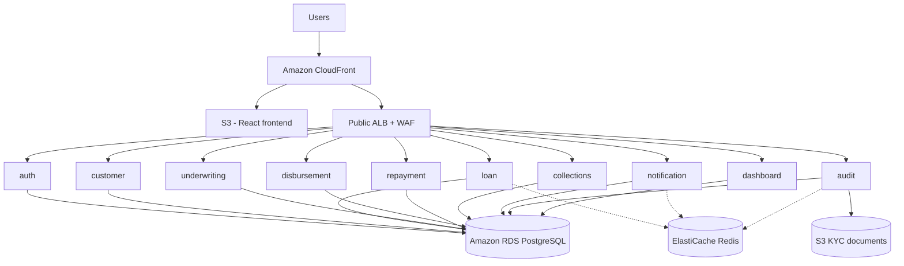

# Loan Management System — AWS DevOps Agent sample application

A full-lifecycle banking loan processing microservices application that demonstrates [AWS DevOps Agent](https://docs.aws.amazon.com/devopsagent/latest/userguide/) autonomous incident response. It powers Module 4 of the *Autonomous Incident Response with AWS DevOps Agent* workshop, alongside the previously published ClaimFlow ([sample-claimflow-devops-agent-workshop](https://github.com/aws-samples/sample-claimflow-devops-agent-workshop)) and PaymentPro ([sample-paymentpro-devops-agent-workshop](https://github.com/aws-samples/sample-paymentpro-devops-agent-workshop)) samples.

The repository contains:

- **Ten microservices** (Python/FastAPI) and a **React/TypeScript dashboard**, deployed to **Amazon ECS Fargate**
- **AWS CDK** infrastructure in `infra/` (VPC, ALB+WAF, RDS PostgreSQL, ElastiCache Redis, CloudFront+OAC, CloudWatch alarms, SNS, and a DevOps Agent webhook Lambda)
- **Three demo labs** in `demo/` that intentionally inject failures so AWS DevOps Agent can investigate them

> **Note**: This sample is for **demonstration and learning purposes**. It is not intended for production use as-is. Review the [Security](#security) section and the [Known limitations](#known-limitations) section before deploying.

## Architecture



| Service | Port | Description |
|---|---|---|
| Auth | 8001 | JWT authentication, RBAC, user management |
| Customer | 8002 | Customer profiles, KYC verification |
| Loan | 8003 | Loan products, applications, eligibility checks |
| Underwriting | 8004 | Maker-checker approval workflow |
| Disbursement | 8005 | Loan agreements, EMI schedule generation |
| Repayment | 8006 | EMI payments, auto-debit simulation, penalties |
| Collections | 8007 | Overdue account management, escalation workflow |
| Notification | 8008 | Email notification simulation |
| Audit | 8009 | Tamper-proof audit trail + KYC document archival to S3 |
| Dashboard | 8010 | Portfolio metrics aggregation |

## Prerequisites

- An AWS account with administrator access
- [AWS CLI v2](https://docs.aws.amazon.com/cli/latest/userguide/getting-started-install.html), configured
- [AWS CDK v2](https://docs.aws.amazon.com/cdk/v2/guide/getting_started.html) (`npm install -g aws-cdk`)
- Node.js 20+ (for the frontend and CDK)
- Python 3.11+ (for services)
- Docker (only required for local development; the GitLab CI builds use kaniko)

## Deploy

### 1. Build and push images, then deploy CDK

```bash
# Sign in to ECR
aws ecr get-login-password --region "$AWS_REGION" \
  | docker login --username AWS --password-stdin "$(aws sts get-caller-identity --query Account --output text).dkr.ecr.$AWS_REGION.amazonaws.com"

# Build all 10 service images
./build-and-push.sh

# Build the React frontend
(cd frontend && npm ci && npm run build)

# Deploy the CDK stack
cd infra
npm install
cdk bootstrap "aws://$(aws sts get-caller-identity --query Account --output text)/$AWS_REGION"
cdk deploy --require-approval never
```

The deployment takes about 10-15 minutes. Stack outputs include:

- `CloudFrontUrl` — the public application URL
- `EcsClusterName` — `loan-management-cluster`
- `AlbDnsName` — ALB DNS for direct API access
- `RdsEndpoint` — PostgreSQL endpoint
- `RedisEndpoint` — ElastiCache Redis endpoint
- `AuditTaskRoleName` — the IAM role that Lab 2 (`demo/lab2-iam-s3-deny`) modifies

### 2. Sync the frontend assets

```bash
FRONTEND_BUCKET=$(aws cloudformation describe-stacks --stack-name LoanManagementSystem \
  --query 'Stacks[0].Outputs[?OutputKey==`FrontendBucketName`].OutputValue' --output text)
aws s3 sync frontend/dist/ "s3://${FRONTEND_BUCKET}/" --delete
```

### 3. Sign in with the demo credentials

The auth-service seeds **a single admin user** with a fixed, well-known
password on first boot. This is a workshop-only credential.

| Username | Password | Role |
|---|---|---|
| `admin` | `Admin12345!` | Administrator |

The seed runs every time the auth-service starts and **upserts** the
admin user — if you change the seed code in
`services/auth-service/app/seed.py` and redeploy, the next boot rewrites
the password hash back to the documented value. Set
`ENABLE_DEMO_SEED=false` (CDK context `-c enableDemoSeed=false`) to
disable the seed entirely; users you create through the UI are never
overwritten.

> The same credential works for the local `docker-compose up` path when
> `ENABLE_DEMO_SEED=true` in your `.env`.

The login page does not display the credential. Workshop participants
get it from this README, the workshop guide, or their facilitator.
This matches the ClaimFlow / PaymentPro / Trading sample pattern.

### Loan processing flow

You exercise the entire loan lifecycle from the single admin sign-in.
The application surfaces every stage as a tab in the sidebar; each step
below maps to one tab.

1. **Sign in** as `admin / Admin12345!` at the CloudFront URL.
2. **Apply for a loan** — open *New Application*, pick a product (Personal Loan),
   amount `25000`, tenure `24` months, monthly income `60000`, purpose any short
   text, and submit. The application appears with status `SUBMITTED`.
3. **Run eligibility** — open *Eligibility & Underwriting*, click **Run Eligibility**
   on the new application. The loan-service rule engine returns a decision
   (eligible / not eligible), a credit score, and a list of reasons in 1–2 seconds.
4. **Approve in underwriting** — on the same screen, click **Approve** and add
   a short reason. The application status moves to `APPROVED`.
5. **Process disbursement** — open *Disbursement & EMI*, click **Process Disbursement**
   on the approved application. The status moves to `DISBURSED` and an EMI
   schedule for the loan is generated and shown on screen.
6. **Pay an EMI** — on the EMI schedule, click **Pay** on the next due
   instalment. Payment history updates with the timestamp.
7. **Collections** — open *Collections* to see the simulated overdue
   accounts table. Click **Escalate ↑** on a case to push it through the
   reminder → overdue notice → legal notice stages.
8. **Audit** — open *Admin Panel* to see seeded users, the loan-products
   catalogue, and the audit-log placeholder. The audit-service also
   writes KYC document blobs to its dedicated S3 bucket whenever the
   workshop's Lab 2 runs against this application.

Each step calls a different backend service through the public ALB.
While you click through, the CloudWatch alarms wired up by the
`MonitoringConstruct` stay quiet — until one of the demo labs
(`demo/lab1-rds-pool-exhaustion`, `demo/lab2-iam-s3-deny`,
`demo/lab3-healthcheck-drift`) injects a fault and the agent picks it
up.

### Using the application outside the workshop

If you adopted this sample and want to run it as a starter for a real
internal tool, do this once:

1. Set `ENABLE_DEMO_SEED=false` (CDK context `-c enableDemoSeed=false`)
   so the auth-service stops upserting the demo admin user.
2. Sign in once with the documented password, then change it through
   the UI. The seed will not overwrite a user you have modified after
   you turn the flag off.
3. Create additional users in the role of your choice (the 5-role
   catalogue is seeded into the database independently of the demo
   admin, so `LOAN_OFFICER`, `UNDERWRITER`, `COLLECTIONS_AGENT`, and
   `CUSTOMER` are all available as `role_id` references).
4. Redeploy. The CDK stack and the rest of the application work the
   same — only the demo seed is now disabled.

## DevOps Agent webhook configuration

The CDK stack provisions a webhook Lambda that signs CloudWatch alarm
payloads with HMAC-SHA256 and POSTs them to a DevOps Agent endpoint.

The webhook URL and HMAC shared secret come from the DevOps Agent console. Pass them as CDK context at deploy time:

```bash
cdk deploy \
  -c devops_agent_webhook_url="https://your-devops-agent-endpoint/webhook" \
  -c devops_agent_webhook_secret="$DEVOPS_AGENT_WEBHOOK_SECRET"
```

Behaviour:

- The URL goes into the Lambda's environment as plain configuration.
- When `devops_agent_webhook_secret` is supplied, the CDK creates a Secrets Manager secret named `loan-management/devops-agent-webhook-secret`. The Lambda's environment carries only the secret ARN; the value is fetched at invocation time.
- When unconfigured, the Lambda still receives alarm events but short-circuits without making a network call.

## Local development

A `docker-compose.yml` is included for running all services locally:

```bash
cp .env.example .env
./scripts/generate-env.sh   # generates strong secrets in .env
cd infrastructure
docker-compose up --build
```

The application will be available at `http://localhost:8000`.

## Demo labs — AWS DevOps Agent

The `demo/` directory contains failure-injection labs:

| Lab | Story | Detection |
|---|---|---|
| `lab1-rds-pool-exhaustion` | Batch credit-score recalculation saturates the RDS connection pool. New loan applications time out waiting for a connection. | RDS `DatabaseConnections` alarm + `QueuePool limit reached` in service logs |
| `lab2-iam-s3-deny` | An "IAM tightening" detaches `s3:PutObject` from the audit-service task role. KYC document archival starts returning 502 with AccessDenied. | CloudTrail `AccessDenied` on `s3:PutObject` from the `audit-service` task role |
| `lab3-healthcheck-drift` | A regulatory upgrade renames the disbursement-service health endpoint from `/health` to `/api/v2/health`. The container health check fires the wrong path. | ALB `UnHealthyHostCount` alarm + ECS task stop reason `Task failed ELB health checks` |

Each lab is a pair of scripts:

```bash
demo/lab1-rds-pool-exhaustion/inject.sh   # break it
demo/lab1-rds-pool-exhaustion/fix.sh      # roll back
```

The labs run from AWS CloudShell with ambient credentials. They never write
real PII or call any third-party endpoint.

## Security

This sample uses simulated banking data and is intended for demonstration. The
infrastructure incorporates the following security controls:

- **Network isolation**: RDS and Redis live in `PRIVATE_WITH_EGRESS` subnets with no public IPs. Security groups allow ALB → ECS, ECS → RDS, ECS → Redis only.
- **Encryption**: RDS storage encryption + IAM auth, ElastiCache transit + at-rest encryption with AUTH token, ECR AES-256, S3 SSE-S3 with `enforceSSL: true`, ALB drops invalid header fields, CloudFront with Origin Access Control on the frontend bucket.
- **WAF**: AWS managed rule sets (`CommonRuleSet`, `KnownBadInputsRuleSet`) plus a rate-based rule (2000 req / 5 min per IP) attached to the ALB.
- **Secrets**: RDS master password, JWT signing key, and Redis AUTH token are generated by Secrets Manager; ECS task definitions inject them as `secrets:` (never as `environment:`). The DevOps Agent webhook HMAC secret, when supplied, lives in a separate Secrets Manager resource.
- **IAM**: Per-service Fargate task roles. Each service receives only the secrets it needs and the audit-service is the only role with `s3:PutObject` on the KYC bucket. Lab 2 detaches that single statement.
- **JWT**: `JWT_SECRET` is **required**, no fallback. Tokens carry `iss`, `aud`, `iat`, `exp`, `jti`. Refresh tokens are rotated on use and persisted with a revoked flag.
- **CORS**: Driven by `CORS_ALLOWED_ORIGINS`. There are no `*` defaults outside `APP_ENV=local`.
- **Login rate limiting**: 10/minute per IP via `slowapi`.

For details on the chaos endpoints (`ALLOW_STRESS_TEST=true`) see [SECURITY.md](SECURITY.md).

## Known limitations

These choices are **deliberate** for a self-contained workshop sample. They
are documented here so reviewers and downstream consumers can make informed
decisions before adopting any pattern from this repository.

| Choice | Why | Hardening for production |
|---|---|---|
| Container base images use floating tags (`python:3.11-slim`, `nginx:alpine`) | Workshop must build from a clean base on first run; SHA pinning would expire and require manual refreshes between events | Pin to `@sha256:...` digests and refresh via Dependabot/Renovate |
| `imageTagMutability: MUTABLE` on ECR repositories in demo mode | Workshop participants iterate by re-pushing `:latest` | Set `productionMode: true` (or `-c productionMode=true`) — flips to IMMUTABLE |
| Single-AZ RDS, single-AZ Redis | Cost control for short-lived workshop accounts | `productionMode: true` switches multi-AZ on, enables deletion protection, 7-day backups |
| Demo seed creates a single admin user with a fixed, documented password (`Admin12345!`) | Allows guided walk-throughs without manual user creation; the password is printed in this README so the workshop is reproducible. The seed upserts on every restart so the documented password is always the active one. | Set `ENABLE_DEMO_SEED=false` (CDK context `-c enableDemoSeed=false`) and register users through the UI. Or change the value in `services/auth-service/app/seed.py` before deploying. |
| Frontend keeps access tokens in `sessionStorage` | Keeps the sample a single-page app | httpOnly refresh-token cookies, short-lived access tokens |
| `EMAIL_SIMULATION=true` (no real SES sends) | No infra dependency, no PII risk | Replace `notification-service` adapter with SES + verified domain |
| `ALLOW_STRESS_TEST=true` exposes the `db-pool-stress` and `stress-test` admin-only chaos endpoints on loan-service | Required for Lab 1 of the workshop | Remove the route file, run chaos through AWS Fault Injection Service instead |
| Shell commands in `demo/` use double quotes around variable expansions but still rely on the operator to review them before running | Workshop scripts expect interactive review on each run | If you want to harden these into CI, lint with `shellcheck` and switch to argument arrays |
| `ENABLE_TRUSTED_HOST=false` on the ECS task definitions | The AWS ALB health-check probe sends the target task's private IP as the `Host` header, so Starlette's `TrustedHostMiddleware` cannot meaningfully validate it without false-positive 400s. The defence-in-depth controls (WAFv2 on the public ALB, private subnets, security groups locked to the ALB SG) provide the same outcome with no false positives. | Replace the ALB→ECS hop with API Gateway + VPC Link and set `ENABLE_TRUSTED_HOST=true` with explicit allowed hosts; or run a small reverse-proxy sidecar that rewrites the `Host` header to the public DNS before forwarding into the application |

### Static-analysis findings disclosed as accepted false positives

The Probe scan run on this repository reports several findings that are
expected for the workshop sample and have been reviewed against the
ClaimFlow / PaymentPro / Trading PCSR precedents. They are accepted as
advisory and disclosed below for reviewer transparency.

| Finding | Where | Why it stays |
|---|---|---|
| `bandit B104` (binding to `0.0.0.0`) | All 10 services' `app/main.py` invocations of `uvicorn.run(host="0.0.0.0", ...)` and the per-service Dockerfile `CMD` | The services run inside ECS Fargate tasks behind a private security group; the only ingress is the ALB. Binding to `0.0.0.0` inside the container is the only way for ECS to reach the service on the configured `SERVICE_PORT`. |
| `bandit B311` (non-cryptographic `random`) | `services/loan-service/app/services.py`, `services/repayment-service/app/services.py` | Used to generate simulated credit scores (680-780 band) and simulated auto-debit success outcomes for the demo. Not security-relevant. Real banking systems would call a credit bureau. |
| `bandit B603/B607/B404` (subprocess) | `services/loan-service/app/routes.py` chaos endpoint | Already gated by `ALLOW_STRESS_TEST=true` (default false) and `ADMIN` role. The argument list is hard-coded; no user input enters the subprocess call. The line carries an explicit `# nosec B603 B607` marker and the import an explicit `# nosec B404` marker. |
| `semgrep is-function-without-parentheses` on `is_active` / `is_revoked` | `services/auth-service/app/services.py`, `services/loan-service/app/services.py`, `services/notification-service/app/services.py` | False positive on SQLAlchemy ORM column descriptors. `User.is_active` is a `Column(Boolean)`, not a method. Each affected line carries an explicit `# nosemgrep: is-function-without-parentheses` marker. |
| `semgrep jsx-not-internationalized` (~170 findings) | `frontend/src/App.tsx` (the only frontend source file) | Localisation is out of scope for the workshop sample. Same accepted precedent as ClaimFlow PCSR V2250509660, PaymentPro PCSR V2252342139, and Trading PCSR V2257386466. |
| `semgrep dockerfile-source-not-pinned` | All service Dockerfiles | See "Container base images use floating tags" row above — the same disclosure applies. |
| `semgrep prefer-json-notation` (Dockerfile `CMD`) | All service Dockerfiles | The `CMD ["sh", "-c", "uvicorn ..."]` form is JSON notation, but the `sh -c` wrapper is required to interpolate `${SERVICE_PORT}`. ECS forwards SIGTERM to PID 1 (`sh`) which propagates to the uvicorn child via `exec` semantics. Functionally equivalent to a direct CMD with no shell wrapper. |
| `grype aws-cdk-lib GHSA-v4mq-x674-ff73 / GHSA-5pq3-h73f-66hr` (INFO) | `infra/package.json` | Both advisories cover CDK constructs (`OpenIdConnectProvider`, `CodePipeline`) that this sample does not use. |
| `npm audit` `esbuild` GHSA-67mh-4wv8-2f99 | `frontend/node_modules/esbuild` (bundled by vite) | Dev-server-only advisory. The production container ships only the static `dist/` produced by vite; `esbuild` is never present at runtime. Same precedent as PaymentPro PCSR V2252342139 and Trading PCSR V2257386466. The fix would require upgrading to vite 6.x or later, which is a breaking change vs the current codebase. |
| `npm audit` `vite` (`server.fs.deny` bypass, optimized-deps `.map` traversal) and `launch-editor` (NTLMv2 hash disclosure on Windows) | `frontend/node_modules/vite`, `frontend/node_modules/launch-editor` | Dev-server-only advisories. All three CVEs are reachable only through the local `vite dev` developer experience. The production container ships only the static `dist/` artefact produced by `vite build`; the dev server and its plugins (including `launch-editor`) are never present at runtime. Same dev-only precedent as the esbuild row above. The fix is to upgrade to vite 7.x (a major-version bump) — accepted as advisory for this workshop sample. |

## Reporting security issues

This is a sample repository. Please follow [AWS vulnerability reporting](http://aws.amazon.com/security/vulnerability-reporting/) for any vulnerability you find. Do not open public GitHub issues.

## License

This library is licensed under the MIT-0 License. See the [LICENSE](LICENSE) file.
